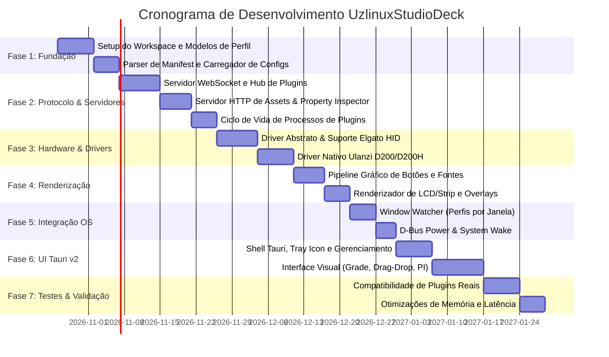

# Plano de Engenharia e Desenvolvimento: Uzlinux Studio

> **Documento de Arquitetura e Engenharia de Port e Compatibilidade em Rust**  
> **Data:** 25 de Outubro de 2026  
> **Referência de Compatibilidade:** Ecossistema OpenDeck (`me.amankhanna.opendeck`, versão 2.14.2) e Elgato Stream Deck  
> **Dispositivo Alvo Primário:** Dispositivos da linha Ulanzi (como o Ulanzi Stream Controller D200/D200H - `e9-02C53A015U3671380`), além de suporte extensível a outros stream controllers do mercado.

---

## 1. Visão Geral Executiva

O objetivo do projeto **Uzlinux Studio** é construir uma estação de controle e automação desktop **nativa, de alto desempenho, segura e modular em Rust**, focada com excelência na integração com produtos da **Ulanzi**, mantendo total interoperabilidade e compatibilidade com:
1. **Plugins oficiais e comunitários do Elgato Stream Deck** (arquivos `.streamDeckPlugin` / `.sdPlugin`).
2. **Property Inspectors (HTML/JS/CSS)** dos plugins sem alteração de código.
3. **Esquema de arquivos e perfis** compatíveis com OpenDeck (`settings.json`, `applications.json`, `profiles/<device>/<profile>.json`).
4. **Dispositivos de Hardware:**
   - Suporte prioritário e integrado ao hardware **Ulanzi Studio Deck D200 / D200H** (identificado como `DeviceNamespace: e9`), eliminando a necessidade de drivers externos.
   - Suporte aberto aos dispositivos Elgato (Stream Deck Mini, Original v1/v2, XL, Plus, Neo, Pedal) e Decks Virtuais.

---

## 2. Resultados da Engenharia Reversa (REA + Ghidra + Runtime)

A inspeção detalhada do binário ELF de 55 MB e das estruturas em tempo de execução no Linux revelou a anatomia exata do OpenDeck:

### 2.1. Metadados de Compilação e Crates Identificados
Através da inspeção de seções estáticas e dos metadados da crate `built 0.8.0` embutidos no binário, foi possível extrair a lista exata das crates e versões utilizadas no OpenDeck:

* **Framework de Aplicação:** `tauri 2.12.1`, `tauri-build 2.7.1`
* **Plugins Tauri:**
  * `tauri-plugin-single-instance 2.4.0` (garante instância única com D-Bus no Linux)
  * `tauri-plugin-autostart 2.5.1` (inicialização com o sistema)
  * `tauri-plugin-dialog 2.6.0` (caixas de diálogo do sistema)
  * `tauri-plugin-deep-link 2.4.7` (manipulação de links `streamdeck://`)
  * `tauri-plugin-log 2.8.0` + `log 0.4.29` + `log-panics 2.1.0`
  * `tauri-plugin-cors-fetch 4.2.0`
* **Comunicação e Rede:**
  * `tokio 1.49.0` (runtime assíncrono completo)
  * `tokio-tungstenite 0.28.0` (servidor WebSocket para o SDK de plugins)
  * `tiny_http 0.12.0` (servidor HTTP local para servir páginas dos Property Inspectors)
  * `reqwest 0.13.1` (download de plugins e verificação de atualizações)
* **Dispositivos USB / Hardware:**
  * `elgato-streamdeck 0.14.0`
  * `hidapi 2.6.4`
  * `streamdeck-strip-render 0.1.0` (renderização de faixas LCD/encoders)
  * `image 0.25.9` (decodificação de PNG, JPEG, BMP, ICO para botões e telas)
  * `font-loader 0.11.0` (carregamento de fontes do sistema para renderizar textos nas teclas)
* **Integração com Sistema Operacional:**
  * `active-win-pos-rs 0.10.1` (monitoramento de janelas ativas para alternância automática de perfil)
  * `sysinfo 0.38.0` (monitoramento de processos e sistema)
  * `fix-path-env` (correção de `$PATH` em ambientes desktop no Linux/macOS)
  * `libc 0.2.180`
* **Serialização e Utilitários:**
  * `serde 1.0.228`, `serde_json 1.0.149`, `serde_with 3.16.1`, `serde-inline-default 1.0.1`
  * `dashmap 6.1.0` (hashmaps concorrentes de alto desempenho para gerenciar instâncias de plugins e conexões)
  * `json-patch 4.1.0`
  * `zip 6.0.0` (extração de `.streamDeckPlugin`)

---

### 2.2. Topologia de Rede e Portas do OpenDeck
Durante a inicialização do módulo `opendeck::plugins`, o sistema aloca dinamicamente uma porta base (ex: 57116):
* **Porta `PORT_BASE` (ex: 57116):** WebSocket Server para os executáveis de plugins (SDK Elgato).
* **Porta `PORT_BASE + 1` (ex: 57117):** WebSocket Server dedicado aos frames de **Property Inspector**.
* **Porta `PORT_BASE + 2` (ex: 57118):** HTTP Server (`tiny_http`) servindo arquivos locais de plugins (`.html`, `.js`, `.css`, imagens) com cabeçalhos de CORS e injeção do script `connectElgatoStreamDeckSocket`.

### 2.3. Especificação do Protocolo de Eventos (Inbound & Outbound)
O protocolo de comunicação segue a especificação Elgato Stream Deck WebSocket:

#### A. Argumentos de Inicialização dos Plugins:
```bash
<plugin_binary> -port <PORT_BASE> -pluginUUID <PLUGIN_UUID> -registerEvent <REGISTER_EVENT> -info <JSON_INFO>
```

#### B. Eventos Inbound (Plugin / Property Inspector -> OpenDeck):
* `setSettings` / `getSettings`: Configurações persistentes da instância da ação.
* `setGlobalSettings` / `getGlobalSettings`: Configurações globais compartilhadas do plugin.
* `setTitle`: Atualiza dinamicamente o texto exibido na tecla.
* `setImage`: Envia imagem codificada em base64 (`data:image/png;base64,...`) para renderização direta na tecla.
* `showAlert` / `showOk`: Exibe indicador visual temporário de aviso (!) ou sucesso (✓) sobre a tecla.
* `setState`: Altera o estado atual de ações multi-estado (ex: toggle ligado/desligado).
* `switchToProfile`: Altera o perfil selecionado em um dispositivo especificado.
* `openUrl`: Abre URL no navegador padrão do sistema.
* `logMessage`: Registra mensagem no log central do OpenDeck.
* `sendToPropertyInspector`: Envia carga útil JSON diretamente para o Property Inspector ativo.
* `sendToPlugin`: Envia mensagem do Property Inspector para o processo do plugin.
* `setFeedback`: Envia dados dinâmicos para a tela LCD / Stream Deck + dials (títulos, valores, ícones).
* `setFeedbackLayout`: Altera o layout do encoder dial (usando `streamdeck-strip-render`).
* `device_registered`: Mensagem específica do OpenDeck usada por plugins que registram dispositivos virtuais ou de terceiros (ex: `rs-ulanzi-d200-linux`).

#### C. Eventos Outbound (OpenDeck -> Plugin):
* `didReceiveSettings` / `didReceiveGlobalSettings`
* `keyDown` / `keyUp`: Disparado quando uma tecla física é pressionada/liberada, contendo coordenadas `row`/`column`, estado e configurações.
* `willAppear` / `willDisappear`: Notifica que a ação tornou-se visível ou foi ocultada na grade do perfil ativo.
* `titleParametersDidChange`: Parâmetros de tipografia alterados pelo usuário.
* `deviceDidConnect` / `deviceDidDisconnect`: Notificação de conexão/desconexão física de hardware.
* `dialRotate`, `dialDown`, `dialUp`, `touchTap`: Eventos específicos do Stream Deck + e dispositivos com encoders/telas touch.
* `applicationDidLaunch` / `applicationDidTerminate`: Notificações de mudança de aplicação em foco.
* `systemDidWakeUp`: Notificação de retorno de suspensão do sistema operacional.
* `propertyInspectorDidAppear` / `propertyInspectorDidDisappear`.
* `didReceiveDeepLink`: Tratamento de URLs registradas no protocolo do sistema.

---

### 2.4. Estrutura de Diretórios e Esquema de Dados Identificados
O OpenDeck armazena suas configurações em `$XDG_CONFIG_HOME/opendeck/`:
```
opendeck/
├── applications.json         # Mapeamento: ID da Janela/App -> { deviceId: profileName }
├── settings.json             # Configurações globais (brilho, timeout, rotação, wine, etc.)
├── images/                   # Imagens personalizadas salvas por dispositivo
│   └── <device_id>/
├── plugins/                  # Plugins instalados (.sdPlugin)
│   ├── com.amansprojects.starterpack.sdPlugin/
│   ├── com.glmagalhaes.ulanzi.d200.sdPlugin/
│   └── ...
├── profiles/                 # Perfis organizados por dispositivo
│   ├── <device_id>.json      # Perfil atualmente selecionado
│   └── <device_id>/
│       ├── Default.json
│       ├── Live.json
│       └── Player.json
└── settings/                 # Configurações globais salvas de cada plugin (<pluginUUID>.json)
```

#### Estrutura de um Perfil (`Profile` JSON):
```json
{
  "keys": [
    {
      "context": "Keypad.0.0",
      "current_state": 0,
      "action": {
        "uuid": "com.amansprojects.starterpack.switchprofile",
        "name": "Switch Profile",
        "plugin": "com.amansprojects.starterpack.sdPlugin",
        "controllers": ["Keypad", "Encoder"],
        "states": [...],
        "property_inspector": "plugins/.../switchProfile.html"
      },
      "settings": { ... },
      "states": [
        {
          "title": "OBS",
          "colour": "#FFFFFF",
          "background_colour": "#000000",
          "size": 16,
          "family": "Liberation Sans",
          "alignment": "bottom",
          "image": "plugins/.../icon.png"
        }
      ],
      "children": null
    }
  ],
  "infobars": []
}
```

---

### 2.5. O Caso Especial do Ulanzi D200 (`com.glmagalhaes.ulanzi.d200.sdPlugin`)
Identificado nos arquivos locais do usuário:
* O dispositivo `e9-02C53A015U3671380` é gerenciado pelo binário `rs-ulanzi-d200-linux`.
* Esse driver se comunica com o OpenDeck via o protocolo WebSocket normal como um plugin, utilizando uma ponte (`openaction_client::OpenActionBridge`) e emitindo `device_registered`.
* Ele implementa:
  * `set_button_image`: Conversão e redimensionamento de imagens para os botões do D200.
  * `set_small_window_data`: Atualização da tela informativa secundária LCD do D200.
  * `set_brightness`: Controle de intensidade do backlight.
* **Oportunidade para o UzlinuxStudioDeck:** Em vez de depender de um processo externo separado que traduz chamadas via IPC, o UzlinuxStudioDeck pode suportar **nativamente no Rust** tanto a interface HID do Elgato quanto a interface USB do Ulanzi D200, mantendo máxima velocidade, latência zero de renderização e estabilidade incomparável.

---

## 3. Arquitetura do Sistema Proposta (UzlinuxStudioDeck)

Para garantir máxima fidelidade, segurança de tipos, alta concorrência e facilidade de manutenção, o projeto será estruturado como um **Rust Cargo Workspace**:

```
UzlinuxStudioDeck/
├── Cargo.toml                       # Workspace manifest
├── crates/
│   ├── uzlinux-core/                # Tipos de dados, modelos de perfil, configurações, eventos
│   ├── uzlinux-protocol/            # Serializadores e parsers dos eventos do Elgato Stream Deck SDK
│   ├── uzlinux-server/              # Servidor WebSocket duplex (tokio-tungstenite) e HTTP (axum ou tiny_http)
│   ├── uzlinux-plugin-manager/      # Descoberta, ciclo de vida de processos, isolamento Wine, extração de .sdPlugin
│   ├── uzlinux-device-driver/       # Abstração de hardware e implementações USB HID (Elgato + Ulanzi D200)
│   ├── uzlinux-renderer/            # Motor de renderização de botões, fontes e faixas LCD (skia/image/cosmic-text)
│   ├── uzlinux-window-watcher/      # Monitoramento de foco de janelas (Wayland/X11) e D-Bus
│   └── uzlinux-app/                 # Aplicação Tauri v2 (backend Rust + frontend Svelte/Vite)
├── ui/                              # Frontend da interface de configuração (Svelte 5 / Vite / TypeScript)
└── docs/                            # Documentação técnica e especificações
```

### 3.1. Detalhamento das Crates

#### 1. `uzlinux-core`
* Estruturas de dados canônicas: `Profile`, `KeyInstance`, `ActionDefinition`, `PluginManifest`, `AppSettings`, `ApplicationProfileMap`.
* Sistema de persistência atômica com escrita temporária (`.tmp`) e renomeação atômica (`fs::rename`), prevenindo corrupção em caso de encerramento abrupto.
* Concorrência global sem locks pesados com `DashMap` para mapear contextos `Keypad.R.C` e dispositivos conectados.

#### 2. `uzlinux-protocol`
* DTOs fortemente tipados para todos os eventos da especificação Elgato Stream Deck:
  * Inbound: `InboundEvent`, `SetTitlePayload`, `SetImagePayload`, `SetSettingsPayload`, `SetFeedbackPayload`, etc.
  * Outbound: `KeyDownEvent`, `KeyUpEvent`, `WillAppearEvent`, `DialRotateEvent`, `TouchTapEvent`, etc.
* Validação estrita de compatibilidade de versões e suporte a extensões personalizadas de hardware.

#### 3. `uzlinux-server`
* Implementação assíncrona com `tokio`:
  * **Plugin WebSocket Hub:** Gerencia sessões bidirecionais de cada plugin iniciado.
  * **Property Inspector WebSocket Hub:** Multiplexa eventos entre a UI de inspeção e o plugin correspondente.
  * **Local HTTP Asset Server:** Serve os arquivos locais com tratamento seguro de paths (mitigando Directory Traversal via `canonicalize`) e injeção do script de bootstrap.

#### 4. `uzlinux-plugin-manager`
* Gerenciador de ciclo de vida de plugins:
  * Parser do arquivo `manifest.json` com suporte a `CodePaths` multiplataforma (`CodePathLin`, `CodePathWin`, `CodePathMac`).
  * Spawner de processos assíncronos (`tokio::process::Command`), passando os parâmetros padrão `-port`, `-pluginUUID`, `-registerEvent`, `-info`.
  * Monitoramento de falhas e suporte a reinício automático de plugins que caírem.
  * Suporte opcional a prefixos isolados do Wine para plugins Windows legados.
  * Instalador de pacotes `.streamDeckPlugin` (descompactador ZIP com validação de segurança).

#### 5. `uzlinux-device-driver`
* Trait abstrata `StreamDeckDevice`:
  ```rust
  #[async_trait]
  pub trait StreamDeckDevice: Send + Sync {
      fn id(&self) -> &str;
      fn model(&self) -> DeviceModel;
      async fn set_brightness(&mut self, percentage: u8) -> Result<()>;
      async fn set_key_image(&mut self, key_index: u8, image_bytes: &[u8]) -> Result<()>;
      async fn set_lcd_strip(&mut self, image_bytes: &[u8]) -> Result<()>;
      async fn clear_all_keys(&mut self) -> Result<()>;
      async fn read_events(&mut self) -> Result<DeviceEvent>;
  }
  ```
* Implementações:
  * **`ElgatoDriver`:** Baseado em `hidapi` e protocolos conhecidos do Stream Deck (Mini, Original, XL, Plus, Neo).
  * **`UlanziD200Driver`:** Driver nativo em Rust que implementa o protocolo USB/HID do Ulanzi D200 e D200H (botões matriciais + tela lateral informativa).
  * **`VirtualDeckDriver`:** Dispositivo virtual em memória para desenvolvimento e testes de interface sem necessidade do hardware físico plugado.

#### 6. `uzlinux-renderer`
* Pipeline de renderização em memória rápida:
  * Camada de imagem base (`image` crate, suporte a PNG, JPEG, SVG, WebP).
  * Composição de texto com sombras, stroke, alinhamento (top/middle/bottom) e quebra de linha usando fontes do sistema via `font-loader` ou `cosmic-text`.
  * Overlays visuais de feedback (`showAlert` com triângulo amarelo, `showOk` com checkmark verde).
  * Renderizador de encoders e faixas LCD para Stream Deck Plus e Ulanzi D200 (layouts flexíveis em JSON).

#### 7. `uzlinux-window-watcher`
* Integração nativa Linux para automação de perfis:
  * Detecção da janela atualmente ativa via `active-win-pos-rs` e D-Bus (`org.gnome.Shell` / `org.kde.KWin` / X11 / Wayland).
  * Detecção de eventos de suspensão/retomada de energia do sistema operacional via D-Bus (`org.freedesktop.login1`).
  * Disparo automático de `applicationDidLaunch`, `applicationDidTerminate` e `switchToProfile`.

#### 8. `uzlinux-app` (Tauri v2 + Frontend)
* Aplicação desktop moderna com Tauri v2:
  * Ícone na bandeja do sistema (`TrayIcon`) com menu de contexto (Troca rápida de perfil, Brilho, Sair).
  * Interface gráfica reativa (SvelteKit ou Svelte 5 com Tailwind/CSS limpo):
    * Visualizador da grade de teclas do dispositivo selecionado.
    * Editor de ações arrastar-e-soltar (Drag-and-Drop).
    * Gerenciador de Perfis e Aplicações vinculadas.
    * Exibição embutida dos Property Inspectors em Webview.
    * Loja e gerenciador de plugins instalados.

---

## 4. Cronograma e Fases de Implementação



### Detalhamento das Fases:

* **Fase 1: Fundação e Estruturas de Dados**
  * Criação do Workspace Cargo com linting rigoroso (`clippy`) e formatação padrão.
  * Definição dos structs `Profile`, `Key`, `State`, `Action`, `Settings` em `uzlinux-core` com testes unitários de serialização compatíveis com os JSONs reais do OpenDeck.
  * Validador e leitor do diretório de configurações existente (`~/.var/app/me.amankhanna.opendeck/config/opendeck`).

* **Fase 2: Protocolo & Engine de Plugins**
  * Implementação dos servidores WebSocket em `tokio-tungstenite` com suporte assíncrono para múltiplos plugins simultâneos.
  * Servidor local de assets HTTP com injeção automática de scripts de compatibilidade para Property Inspectors.
  * Spawner de processos de plugins (`.sdPlugin`) com redirecionamento de logs para `opendeck.log` estruturado.

* **Fase 3: Camada de Hardware e Drivers**
  * Implementação do driver USB HID para Elgato Stream Deck com auto-detecção e hot-plugging via `udev`.
  * Implementação do driver nativo para o Ulanzi D200/D200H (suporte a botões físicos e LCD lateral de status).
  * Sistema de despacho de eventos de teclas (`keyDown`/`keyUp`) com debounce e baixa latência.

* **Fase 4: Motor de Renderização de Teclas e LCD**
  * Renderizador offscreen em Rust: combinação de imagem de fundo + ícone de ação + texto estilizado (cor, tamanho, fonte do sistema, alinhamento, contorno).
  * Cache inteligente de buffers de imagem para evitar renderizações redundantes quando a tecla não sofre alteração de estado.
  * Suporte aos ícones de status dinâmicos (`showAlert`, `showOk`).

* **Fase 5: Automação e Integração Linux**
  * Monitor de foco de janelas em background via `active-win-pos-rs` e APIs D-Bus.
  * Alternância automática de perfis por aplicação cadastrada em `applications.json`.
  * Gerenciamento de economia de energia e desligamento da tela/backlight por inatividade (`device_sleep`).

* **Fase 6: Interface Desktop Tauri v2**
  * Criação do app desktop com Tauri v2, ícone na bandeja do sistema e atalhos globais.
  * Frontend responsivo e estético com visualização fiel das teclas físicas do dispositivo ativo.
  * Drag-and-drop de ações da barra lateral para a grade de teclas.
  * Integração de Property Inspectors em Webview interna.

* **Fase 7: Validação e Testes de Conformidade**
  * Teste exaustivo com os plugins já instalados na máquina do usuário:
    * `com.amansprojects.starterpack.sdPlugin` (Comandos, URLs, Atalhos, Brilho)
    * `dev.theca11.multiobs.sdPlugin` (OBS Studio WebSocket)
    * `com.sfgrimes.pipewire-audio.sdPlugin` (Controle de volume PipeWire)
    * `me.amankhanna.oampris.sdPlugin` (Controles de mídia MPRIS)
    * `com.glmagalhaes.ulanzi.d200.sdPlugin` (Comportamento nativo no D200)
  * Verificação de uso de memória (alvo: < 60 MB RAM em repouso) e latência de clique (< 5 ms).

---

## 5. Critérios de Sucesso e Fidelidade

1. **Interoperabilidade Total:** Capacidade de ler e gravar exatamente os mesmos arquivos de perfil de `~/.var/app/me.amankhanna.opendeck/config/opendeck` sem nenhuma perda de dados.
2. **Execução Transparente de Plugins:** Qualquer plugin construído para o Elgato Stream Deck ou OpenDeck deve funcionar sem modificações.
3. **Desempenho Superior:** Inicialização quase instantânea (< 300 ms), baixo uso de CPU (< 0.1% em idle) e rendering em tempo real.
4. **Experiência Nativa Linux:** Suporte robusto a Wayland e X11, integração com D-Bus e sem dependências pesadas de bibliotecas de compatibilidade externa.
